# training-synth

A friendly, generic app for training YOLO models in your browser: detection, segmentation, pose (keypoints),
rotated boxes (OBB) and classification.

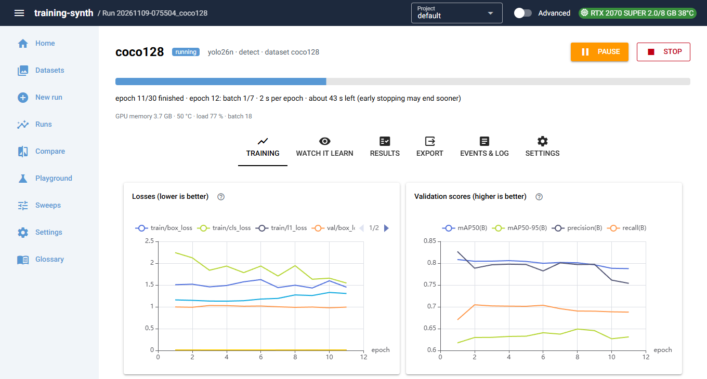

You:
1. load a dataset and check its health;
2. pick a base model from a dropdown;
3. tweak as much or as little as you like;
4. train it, with live charts and pause/resume;
5. evaluate the result, try it on your own images, and export it.

Beginners get recommended values and explanations everywhere (**Simple** mode). Experienced users get every
parameter, raw YAML, sweeps and a CLI (**Advanced** mode).

**New here?** [Install](#install-windows-linux) the app, then follow
[Your first model in 10 minutes](#your-first-model-in-10-minutes).

## Install (Windows, Linux)

Requirements: Python 3.10-3.12, and an NVIDIA GPU with a recent driver (training on the CPU works, but slowly).
Without an NVIDIA GPU, skip the `pip install torch` line.

```bash
git clone https://github.com/ama24/training-synth.git
cd training-synth
python -m venv .venv
.venv\Scripts\activate                 # Linux: source .venv/bin/activate
# PyTorch with CUDA first (pick the right CUDA version on pytorch.org; this is CUDA 12.4):
pip install torch==2.6.0 torchvision==0.21.0 --index-url https://download.pytorch.org/whl/cu124
pip install -e ".[export,dev]"
training-synth gui                              # opens http://localhost:8090
```

To reproduce the exact tested environment, install the pinned versions instead:
`pip install -r requirements.lock.txt`.

Everything (datasets, runs, settings) lives in the **workspace** folder:
- default: `~/training-synth-workspace` (a `~/model-trainer-workspace` from before the rename keeps
  being used);
- or set `TRAINING_SYNTH_HOME` (the old `MTRAIN_HOME` still works), or pass `--workspace`.

To open the app again later, activate the environment and run `training-synth gui`.

## Your first model in 10 minutes

This walkthrough trains a small detector on coco128, a public sample of 128 everyday photos. The training itself
took about 3 minutes on an RTX 2070 SUPER.

### 1. Get the sample dataset

Run these in the activated environment, in any folder. They work in PowerShell, cmd and bash.

```bash
python -c "import urllib.request as u; u.urlretrieve('https://github.com/ultralytics/assets/releases/download/v0.0.0/coco128.zip', 'coco128.zip')"
python -m zipfile -e coco128.zip .
python -c "import ultralytics, shutil, pathlib as p; shutil.copy(p.Path(ultralytics.__file__).parent / 'cfg/datasets/coco128.yaml', 'coco128/data.yaml'); print(p.Path('coco128').resolve())"
```

The last command prints the full path of the dataset. Copy it. If the download fails, try again later or open the
link in a browser and put the zip in this folder.

### 2. Import it

Start the app with `training-synth gui`. Open **Datasets**, press **Import dataset**, paste the path and press
**Import**.

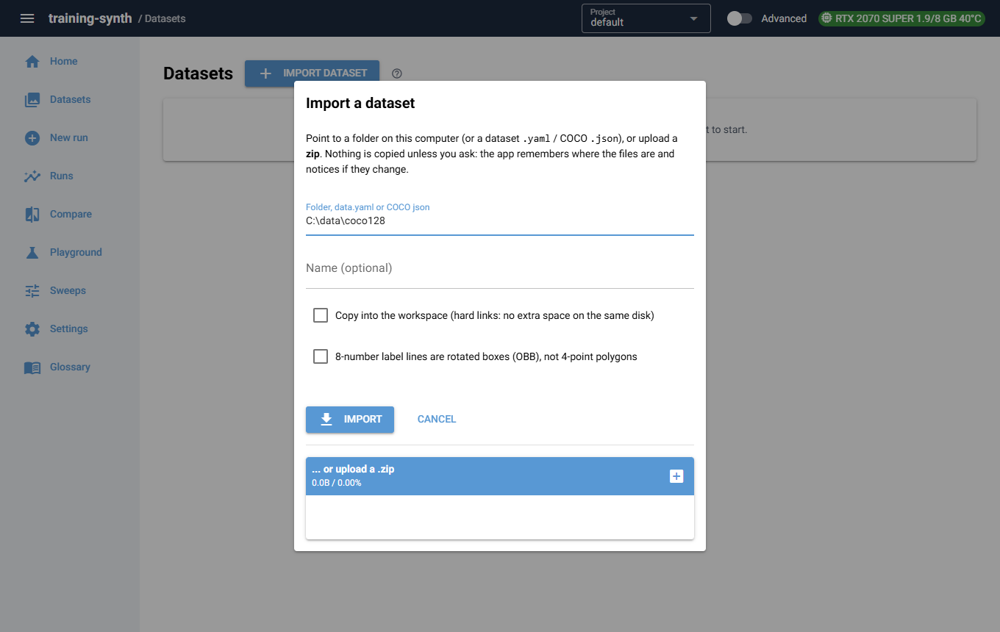

### 3. Read the health report

The app checks the dataset before you spend time training. Open any card to see what it means, why it matters and
what to do.

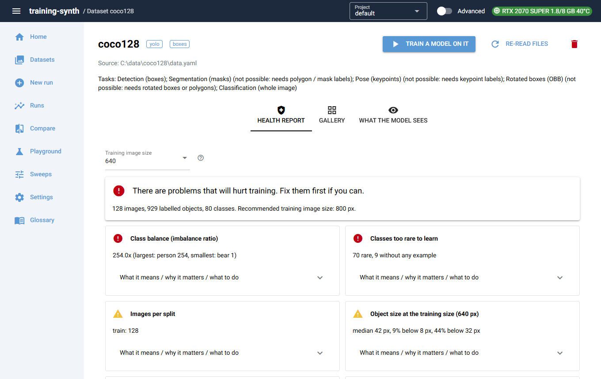

Red cards are expected for this sample, because 128 images cannot cover 80 classes well. On your own data, try to
fix red cards before training. The **Gallery** tab shows every image with its labels.

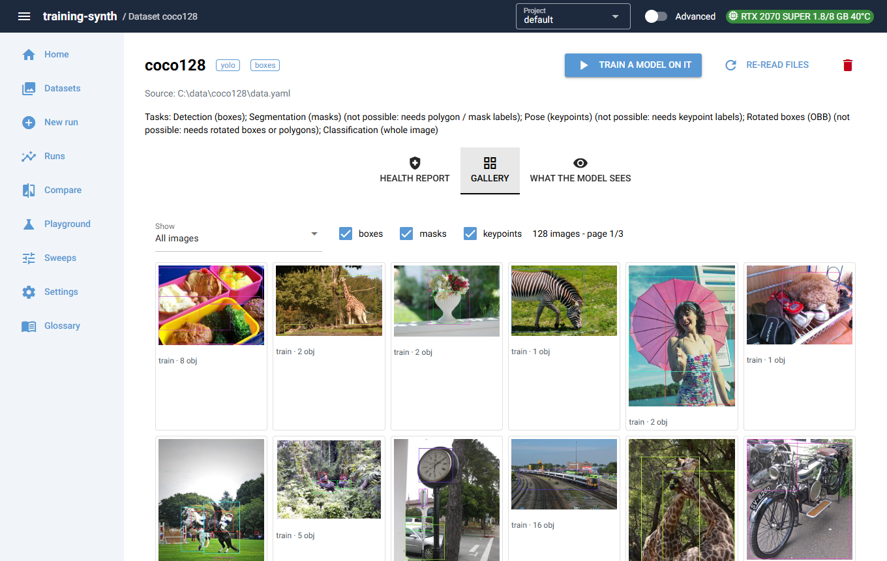

### 4. Set up the run

Press **Train a model on it** to open the wizard, and leave **Simple** mode on. Press **Next** to move between steps.

**Dataset & classes.** Open **Balance, splits and quick tests** and choose **Make a new split**. This sample needs it
because it has no validation images. Your own dataset may already have them.

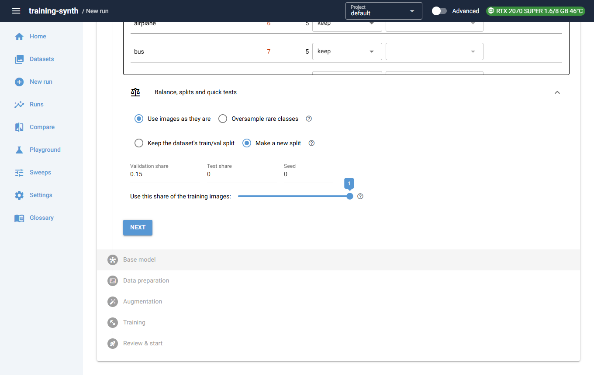

**Base model.** Keep the recommendation and **Pretrained**. The table estimates the GPU memory and the time per epoch
of each size.

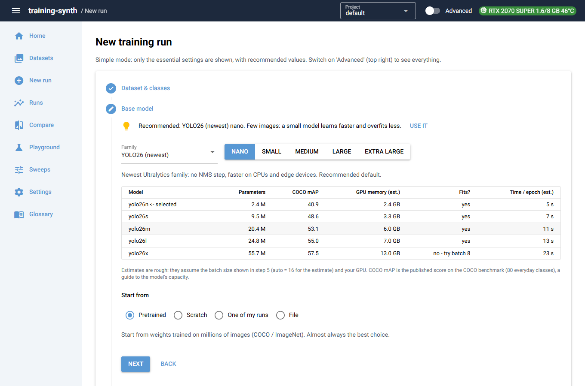

**Data preparation** and **Augmentation.** Keep the defaults.

**Training.** Set **Epochs** to 30 for this first test.

**Review & start.** Read the estimates and warnings, then press **Start now**.

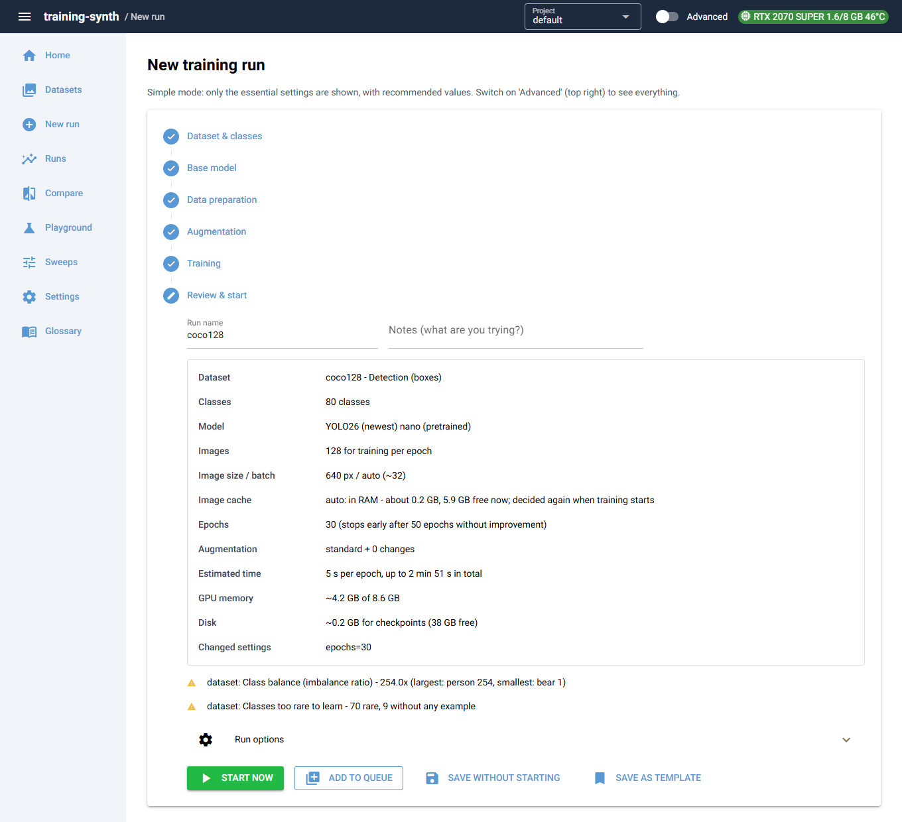

### 5. Watch it train

The run page updates after every epoch. You can close the browser and training continues. **Pause** frees the GPU at
the end of the epoch, and **Resume** continues where it stopped.

The charts at the top of this page come from this run. They look flat because the pretrained weights already know
these 80 classes. On your own classes, expect the losses to fall and the scores to rise, then level off.

**Watch it learn** shows the predictions on the same validation images as training goes on.

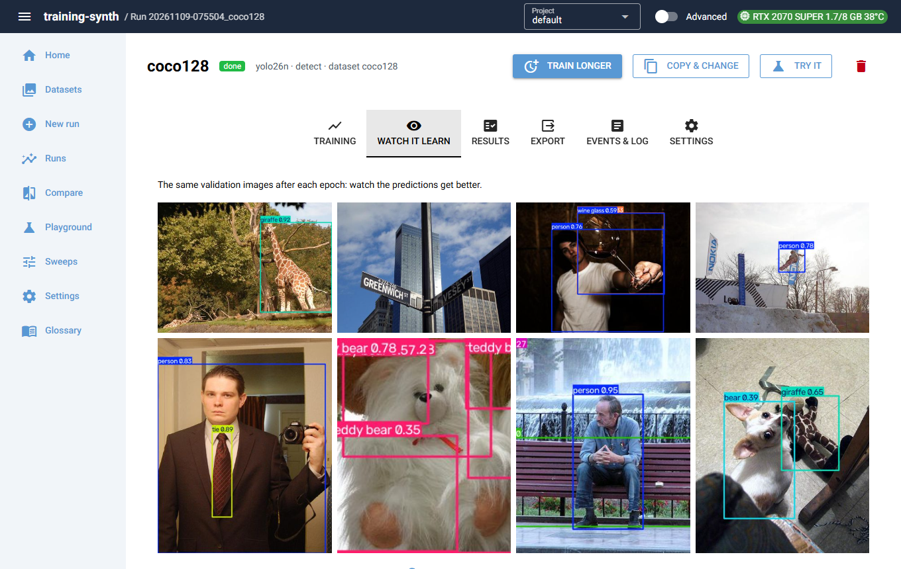

### 6. Check the results

When the run ends, open the **Results** tab. It has a plain-language summary, the score per class and, further down,
the confusion matrix and the images the model got wrong. This run reached mAP50-95 0.64, where 1.0 would be perfect.
With only about 20 validation images, treat that number as a rough guide.

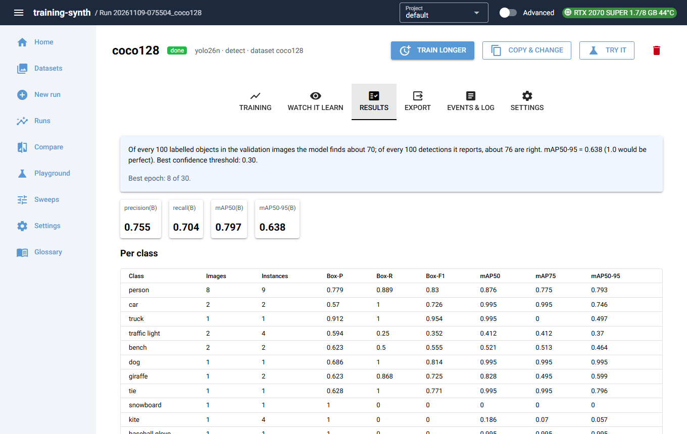

### 7. Try it on new images

Press **Try it** to open the **Playground**. Drop in some images, then press **Run again** to see the predictions.
Use photos the model has never seen: this is the real test.

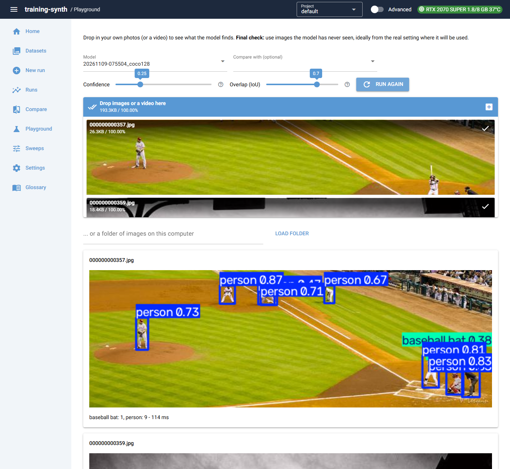

### 8. Export it

On the **Export** tab, pick a format and precision and press **Export**. The exported model is re-scored, so you can
see whether it lost accuracy. Everything another program needs is in the `package` folder shown on that tab (see
[Using the models elsewhere](#using-the-models-elsewhere)).

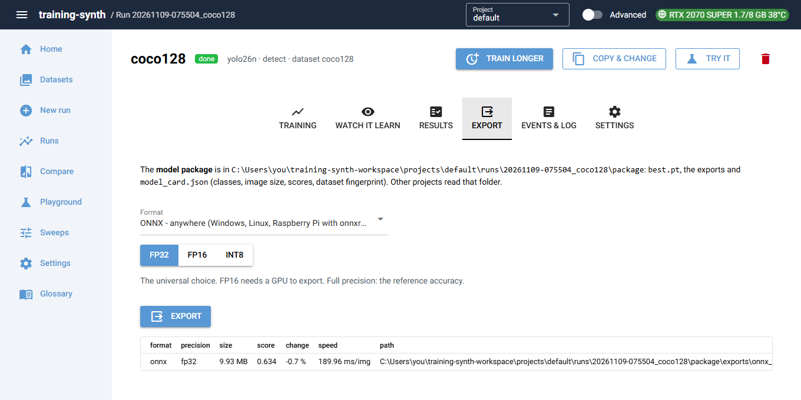

## Train on your own data

Import a folder in one of these layouts:

```
my_dataset/                      # YOLO, which most labelling tools can export
  data.yaml                      # names: {0: cat, 1: dog}, train: images/train, val: images/val
  images/train/*.jpg   labels/train/*.txt
  images/val/*.jpg     labels/val/*.txt
```

COCO json files and one folder per class also work. The [user guide](docs/USER_GUIDE.md) covers each format, explains
each decision in the wizard and lists what to try when results are poor.

**Tip:** start with a quick test. In the first wizard step, under **Balance, splits and quick tests**, lower the share
of training images to 10-20 %. If that run learns something, start the full run.

## If something goes wrong

| Problem | What to do |
|---|---|
| Port 8090 is already in use | The app may already be running. To start a second copy, use `training-synth gui --port 8091`. |
| The first run seems stuck at the start | It is downloading the pretrained weights. This needs internet access once per model. |
| Training is very slow on a PC with an NVIDIA GPU | PyTorch may not see the GPU. Reinstall it with the CUDA version that matches your driver, from [pytorch.org](https://pytorch.org). |
| "GPU out of memory" | Training restarts by itself with half the batch. If it keeps happening, choose a smaller model or image size. |
| An `onnxruntime-gpu` install warning during ONNX export | Ultralytics tries to install that package by itself. If the install fails, the export still finishes, and the speed shown is the CPU speed. |
| `training-synth dataset import` rejects a zip | The command line needs an unpacked folder. Only the app's import dialog takes a zip. |

## What it does

| Screen | What you can do |
|---|---|
| **Datasets** | Import YOLO, COCO or class-folder datasets (folder, yaml/json or zip). **Health report**: split sizes, class balance and imbalance ratio, rare classes, object size at your training resolution, crowding, object-position heatmap, label errors, duplicate images and leakage between train/val, groups. Each check says what it means, why it matters and what to do. **Gallery** with boxes, masks and keypoints, filtered by class, split or problem. **What the model sees**: real augmented training samples. |
| **New run** (wizard) | 1. Dataset, task (only the ones the labels allow), keep/drop/merge/rename classes, oversampling, new stratified group-aware split, quick-test subset. 2. Base model: YOLO26 / YOLO11 / YOLOv8 / RT-DETR × nano…x-large, with estimated GPU memory, "fits?" and time per epoch, plus a recommendation. Start from pretrained, scratch, an earlier run or a file. 3. Image size (recommended from the object sizes), caching, rect. 4. Augmentation presets plus every slider. 5. Epochs, patience, batch, optimizer, learning rate schedule, loss weights, raw YAML. 6. Review with time, memory and disk estimates and the problems found, then Start, Queue, or Save as template. |
| **Run** | Live losses, scores and learning rate per epoch, per-class table, GPU memory/temperature, ETA. **Pause** (end of epoch, frees the GPU), **Resume**, **Stop**, **Train longer**. **Watch it learn**: the same validation images after every epoch. Warnings for overfitting, plateaus, NaN, a hot GPU and low disk. **Results**: plain-language summary, per-class scores, clickable confusion matrix, PR/F1 curves with the best confidence threshold, error gallery (missed, false, wrong class, poor box), recall by object size. **Export**: ONNX, TensorRT, OpenVINO, NCNN (Raspberry Pi), TFLite, CoreML in FP32/FP16/INT8, each re-scored and timed. |
| **Compare** | Overlay any metric across runs, see the settings that differed, find the best run. |
| **Playground** | Drop images, a folder or a video. One model or two side by side, confidence/IoU sliders. Score on an external labelled set. Save predictions as a new dataset to correct (active learning). |
| **Sweeps** | Grid or random search over any settings, queued, with a time budget, ranked. |
| **Settings** | Phone notifications (ntfy), SSH machines for remote training and Raspberry Pi benchmarks. |

## Safety: runs survive crashes and power cuts

- **Checkpoints:** after every epoch a full checkpoint (with the optimizer state) is saved and verified.
  - Resume continues exactly where training stopped, also after a crash or power loss.
  - Snapshots every N epochs let you go back.
- **Frozen data:** every run trains on its own frozen copy of the dataset (hard links, so no extra space), with
  a SHA-1 of every file. Resume refuses if those files were changed.
- **Detached training:** training runs in its own process. Closing the browser or the app does not stop it.
- **No sleep:** the computer is kept awake while training.
- **Out-of-memory recovery:** when the GPU runs out of memory, training restarts in a fresh process with half
  the batch size and keeps the finished epochs. When the PC's RAM runs out, it first turns off the image cache,
  then halves the data loader workers, then the batch. A fresh process is needed because a failed attempt does
  not give its memory back.
- **Automatic image cache:** with "Cache images: auto" (the default), the training-size images are kept in RAM
  when they fit in the free memory at the start of training (twice their size plus 4 GB), for faster epochs.
  More RAM in the PC is used automatically.

## Command line

```bash
training-synth dataset import path/to/dataset --name parts
training-synth dataset check parts --imgsz 1024
training-synth run new --dataset parts --model yolo26s --epochs 100 --imgsz 1024 --start
training-synth run list
training-synth run status <run> --follow
training-synth run pause <run>      # / resume / stop / extend --epochs 200
training-synth run export <run> --format onnx --precision fp16
training-synth predict --run <run> --source photos/
training-synth sweep create --base <run> --space space.yaml --mode grid --budget-hours 8
training-synth notify-test
```

## Using the models elsewhere

A finished run has a **model package** in `<run>/package/`:
- `best.pt`;
- the exports;
- `model_card.json`: task, classes in order, image size, scores, recommended confidence, the dataset fingerprint and
  class mapping, the training settings and versions;
- the dataset's own extra files, if its yaml lists them as `package_files: [classes.yaml, parts.json]`
  (screw-synth does): copied when the run starts, so the package keeps the versions it was trained with, and
  listed in the card under `package_files`.

To use the model elsewhere, zip the `package` folder. Check the class list in the card before using a model in
another project.

## Development

```bash
pytest -m "not slow"     # fast tests (datasets, GUI with a simulated user, run manager, CLI)
pytest -m slow           # real tiny training runs: pause/resume/extend, crash recovery, export (GPU recommended)
ruff check . && ruff format --check .
```

## Docs

- [docs/USER_GUIDE.md](docs/USER_GUIDE.md): a walkthrough for your first model.
- [docs/DESIGN.md](docs/DESIGN.md): the design.

Licence: AGPL-3.0 (it builds on [Ultralytics](https://github.com/ultralytics/ultralytics), which is AGPL-3.0).
